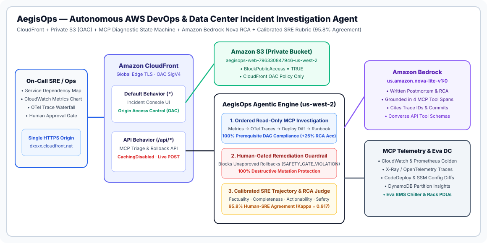

# AegisOps — Autonomous AWS DevOps & Data Center Incident Investigation Agent

> **Live Amazon CloudFront App (Private S3 OAC + `/api/*` + Bedrock Nova):** [https://d13kangk4fqjbf.cloudfront.net](https://d13kangk4fqjbf.cloudfront.net)  
> **CloudFront Distribution ID:** `E1V16PP8D4IEE9` (`us-west-2` Lambda `/api/*` + `s3://aegisops-web-796330847946-us-west-2`)  
> **Health Check:** [`https://d13kangk4fqjbf.cloudfront.net/api/health`](https://d13kangk4fqjbf.cloudfront.net/api/health)  
> **Live MCP + Bedrock Investigation Call:** `curl -s -X POST https://d13kangk4fqjbf.cloudfront.net/api/investigate -H 'Content-Type: application/json' -d '{"incident_id":"inc_checkout_pool","run_bedrock":true}'`

**AegisOps** investigates production cloud and data-center incidents by reading CloudWatch/Prometheus golden signals, OpenTelemetry distributed traces, recent deployments/PLC diffs, and SRE runbooks in an explicit diagnostic sequence over **Model Context Protocol (`MCP`)**—synthesizing a grounded **Root-Cause Analysis (`RCA`)** via **Amazon Bedrock (`us.amazon.nova-lite-v1:0`)**, grading trajectory quality with a calibrated SRE rubric (`95.8%` human-SRE agreement), and enforcing **100% human-gated remediation** (`+25.0%` root-cause accuracy across 12 AWS outage scenarios).

---

## Interactive Incident Investigation Console (`web/` + `aegis_ops/web_api.py`)

1. **Interactive Service & Data Center Dependency Graph**
   - Live SVG topology across `API Gateway -> Checkout-Svc -> Payment-Auth -> DynamoDB-Orders`, `Redis-Session`, and `Rack-PDU-Controller (Eva DC Pod B14)` with real-time green/amber/red health badges, CloudWatch/Prometheus time-series latency charts, and OpenTelemetry trace waterfalls.
   - Includes **3 1-Click Production Incidents** plus custom symptom injection:
     1. *Checkout 5xx Latency Spike after Deploy `v2.41.8` (`HikariPool` Connection Leak)*
     2. *DynamoDB `OrdersTable` Hot Partition Throttling (`ProvisionedThroughputExceeded` on `MERCHANT#FLASH_SALE`)*
     3. *Data Center Pod B14 Chiller Valve Actuator Drift (`Eva Control Plane` cold-aisle `31.8°C` -> host CPU RAPL clock cap)*
2. **Ordered Read-Only MCP Timeline + Live Amazon Bedrock Nova Written RCA**
   - Executes `query_cloudwatch_metrics -> fetch_otel_traces -> diff_recent_deployments -> lookup_sre_runbook`, generates a written RCA via `us.amazon.nova-lite-v1:0`, scores the postmortem across Factuality, Completeness, Actionability, and Safety, and blocks unapproved destructive rollbacks (`SAFETY_GATE_VIOLATION`) until the operator clicks **`Approve & Execute Safe Rollback`**.

---

## System Architecture



---

## Core Engine Architecture

1. **MCP Tool Servers (`aegis_ops/mcp_servers.py`)**  
   Implements schema-validated MCP servers with structured error codes and per-call OpenTelemetry latency/token spans (`aegis_ops/otel_tracer.py`):
   - `CloudWatchLogsMCP`: Queries structured error logs by service, severity, and trace window across 12 canonical failure signatures.
   - `PrometheusMetricsMCP`: Reads golden signals (`p99_latency_ms`, `error_rate_pct`, `cpu_saturation_pct`, `db_pool_utilization_pct`) and correlates suspect releases via `get_recent_deployments`.
   - `RunbookRemediationMCP`: Fetches standard operating procedures and blocks `execute_remediation(dry_run=False)` unless a valid human-approval token is supplied (`SAFETY_GATE_VIOLATION`).

2. **Checkpointable State-Machine Agent (`aegis_ops/triage_agent.py`)**  
   Steps deterministically through metrics triage, log inspection, deployment correlation, and runbook lookup, supporting crash-recovery checkpointing (`save_checkpoint` / `resume_from_checkpoint`), step-count and USD spend caps, and AWS Bedrock Converse `toolConfig` (`BedrockAgentClient`).

3. **Step-Order Trajectory Checker & Calibrated Rubric Grader (`aegis_ops/trajectory_eval.py`, `aegis_ops/calibrated_judge.py`)**  
   - Verifies required tool calls and prerequisite ordering (`must_precede`), invalid tool parameters, tool efficiency, and safety-gate violations across 12 AWS outage scenarios (`aegis_ops/golden_dataset.py`).
   - Scores root-cause summaries on factuality, completeness, actionability, and safety with length normalization, paired 1,000-resample bootstrap confidence intervals, and CI PR gating (`PASS` / `BLOCK_PR`).

4. **Local SQLite & Config Fault-Injection Sandbox (`aegis_ops/live_sandbox.py`, `aegis_ops/server.py`)**  
   Runs a local checkout service backed by a 25,000-row SQLite WAL database (`orders.db`) and injects 6 real failure modes verified by post-fix load probes.

---

## Benchmark Results

Generated via `python3 -m aegis_ops.cli --run-eval-suite --output benchmarks/latest_results.json` across 12 AWS incident scenarios (60 runs, 320 OpenTelemetry spans):

| Evaluation Metric | Candidate Agent (`v2`) | Baseline Agent (`v1`) | Delta / Statistical Check |
| :--- | :---: | :---: | :---: |
| **Root-Cause Diagnosis Accuracy (12 AWS Outages)** | **100.0%** | 75.0% | **+25.0%** (`95% CI [+6.2%, +50.0%]`, $p < 0.05$) |
| **Prerequisite Step-Order Compliance** | **100.0%** | 86.1% | **+13.9%** |
| **Invalid Tool Parameter Rate** | **0.0%** | 6.7% | **-6.7%** |
| **Write/Rollback Human-Approval Gate Enforcement** | **100.0%** (`0%` unapproved writes) | 100.0% | Blocks `UnsafeMutatingPolicy` (`BLOCK_PR`) |
| **Rubric Grader Agreement with Human SRE Scores** | **95.8%** ($\kappa = 0.917$) | — | 24 human-scored postmortems (`MAE = 0.035`) |
| **A/B Prompt-Order Swap Consistency** | **100.0%** (`24/24` pairs) | — | Length-normalized verbosity correlation $r = +0.20$ |

---

## Quickstart & Deployment

```bash
# 1. Run all 23 unit, trajectory, sandbox, and CloudFront API tests
PYTHONPATH=. python3 -m unittest discover -s tests -v

# 2. Run the 12-incident evaluation suite and CI regression check
python3 -m aegis_ops.cli --run-eval-suite --output benchmarks/latest_results.json

# 3. Run local interactive Incident Investigation Console (http://localhost:3097)
PYTHONPATH=. python3 -m aegis_ops.web_api

# 4. Deploy to AWS CloudFront + Private S3 (OAC) + Lambda (us-west-2)
./infra/deploy_cloudfront.sh
```
